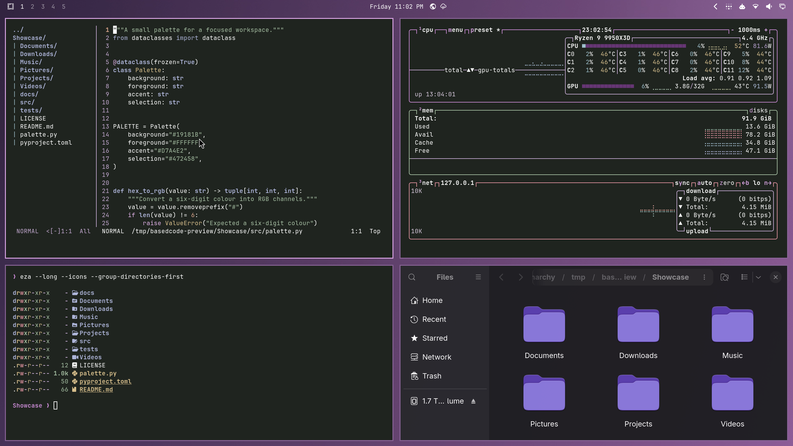

# Basedcode for Omarchy

A brighter purple companion to [Basedcode Dark](https://github.com/BasedCodeDev/omarchy-basedcode-dark-theme):
charcoal working surfaces, white text and lilac focus accents, extending the approved
purple gradient wallpaper through the desktop. The wallpaper contains no text or logos.
Basedcode is the purple variant; application appearance uses native dark mode.



Built against Omarchy **4.5.0-3** and the [BasedCode Brand Bible v2.4](https://brand.basedcode.dev/).
This repository retains the dark theme's Git ancestry and is maintained as a separate theme.

## Install

```sh
omarchy theme install https://github.com/BasedCodeDev/omarchy-basedcode-theme
```

Omarchy installs and activates `basedcode`. Its installer replaces an existing theme
with that name: back up local changes first. The dark `basedcode-dark` theme remains separate.
Requires Omarchy's native theme generator and video-wallpaper support, plus Yaru-purple icons.
JetBrainsMono Nerd Font is recommended; fonts and icons are not bundled or installed.
Native dark mode selects Adwaita-dark for applications without a custom palette.

For a backup-aware installation from a local clone, run as your normal desktop user:

```sh
python scripts/install.py --apply
```

This saves the current theme, wallpaper and appearance settings under
`~/.local/state/omarchy/basedcode-backups/`, printing the exact backup directory.
It suppresses theme mirroring to other machines for that invocation. It preserves user
fonts, sizes, layouts, keybindings, monitor settings and transparency preferences.

## Wallpaper and rollback

Choose motion or still in the background picker, or run:

```sh
omarchy theme bg set ~/.config/omarchy/themes/basedcode/backgrounds/02-basedcode-still.png
omarchy theme bg set ~/.config/omarchy/themes/basedcode/backgrounds/01-basedcode-motion.mp4
```

The motion version is a silent 1920×1080, 30 fps, 16-second loop with a 4K still. Selecting the still stops video
playback; no additional wallpaper service is installed. Native lock-screen blur is retained.

To switch to the dark sibling, if installed:

```sh
omarchy theme set basedcode-dark
```

To restore the exact appearance saved by the backup-aware installer:

```sh
python scripts/rollback.py ~/.local/state/omarchy/basedcode-backups/TIMESTAMP
```

Use the timestamp printed during installation. The new light theme remains available.

## Design and coverage

The approved reference supplies a rich purple field. Working surfaces use `#1F241F`,
panels `#272D27`, sidebars `#191D19`, white primary text and `#C1A7CE` muted text.
Lilac `#D7A4E2` marks focus; selections use white on `#663674`. Semantic colours
preserve readable code, errors, warnings and diffs.

Omarchy generates terminal, Aether/Neovim, Helix, btop and other integrations from the palette.
The colour-only VS Code override retains native syntax mapping while fixing button and focus
contrast. User application overrides still take precedence, including Neovim transparency.
See [design decisions](docs/DESIGN.md) and [validation evidence and limits](docs/VALIDATION.md).

## Rebuild and contribute

Use Python 3.11+, the pinned dependencies, FFmpeg with libx264, and the tested Omarchy
installation. Review-sheet rendering also needs Fontconfig and JetBrains Mono.

```sh
python -m venv .venv
.venv/bin/pip install -r requirements.txt
.venv/bin/python scripts/build_shell.py
.venv/bin/python scripts/build_editor.py
.venv/bin/python scripts/render.py --video
.venv/bin/python scripts/review.py
.venv/bin/python scripts/validate.py
.venv/bin/python scripts/check_motion.py
.venv/bin/python scripts/check_wallpaper.py
.venv/bin/python scripts/check_apps.py
.venv/bin/python scripts/check_staging.py
.venv/bin/python scripts/package.py
```

The staging check uses the installed dark sibling for its isolated round trip. It does not
switch the live desktop. `scripts/live_smoke.py` and `scripts/benchmark.py` are opt-in live
checks: they temporarily switch workspaces/themes or wallpapers and should be run knowingly.
The smoke check targets the development workstation's DP-1 display; adapt that selector
before running it on another machine. No live checks run during ordinary installation.

`theme/` is the source of runtime files. `src/design.json` records brand and motion decisions.
The package script synchronises runtime files to the repository root for direct Git
installation; commit both copies. Git deduplicates identical contents. It also builds runtime
and source archives with SHA-256 checksums in `dist/`. Private captures, rollback records,
build caches, virtual environments and archives are excluded from Git and public packages.

Render with `--width 2560 --height 1440 --video` for a larger animation; the still remains 4K.
Build inputs and validation results are in `qa/`. Reproducibility assumes matching dependencies
and encoder versions. Screenshots must be reviewed before including them in a public package.

## Rights

Original code and procedural artwork are MIT-licensed; see [LICENSE](LICENSE).
BasedCode brand rights remain separate. See [brand rights](BRAND-RIGHTS.md) and
[third-party notices](THIRD-PARTY-NOTICES.md).

## Desktop preview

The preview is a real 2560×1440 capture with Neovim and its file tree, btop, a
terminal directory listing, and GNOME Files. Both variants use the same layout
and sample files. btop shows loopback networking instead of a private network
address, with the process list hidden. Fonts and monitor scaling are unchanged.
Files uses the native dark GTK appearance with Yaru-purple icons.

## Theme naming migration

The purple variant previously called **BasedCode Light** is now **Basedcode**
(`basedcode`, `BasedCodeDev/omarchy-basedcode-theme`). The grey variant previously
called **BasedCode** is now **Basedcode Dark** (`basedcode-dark`,
`BasedCodeDev/omarchy-basedcode-dark-theme`). Appearance and screenshots are unchanged.

The old unsuffixed GitHub URL now identifies the purple variant. Existing dark-theme
users must update their remote to `https://github.com/BasedCodeDev/omarchy-basedcode-dark-theme.git`.
Install the renamed dark variant before installing the purple variant to avoid replacing
an existing `basedcode` installation. Back up local changes and custom wallpapers first.
Use the new URLs explicitly: redirects do not change the theme slug derived from an old URL.

Historical rollback records remain untouched. The updated rollback script maps pre-rename
`basedcode` records to `basedcode-dark` and `basedcode-light` records to `basedcode`.
New records include versioned identity metadata and use the current names.
